## Mental Accounting (Recap)


<style type="text/css">
    table.table-style-one {
        font-size:36px;
        color:#333333;
        border-width: 1px;
        border-color: #D3D3D3;
        border-collapse: collapse;
    }
    table.table-style-one th {
        border-width: 1px;
        padding: 16px;
        border-style: solid;
        border-color: #3A3A3A;
        background-color: #B3B3B3;
    }
    table.table-style-one td {
        border-width: 1px;
        padding: 16px;
        border-style: solid;
        border-color: #D3D3D3;
        background-color: #ececec;
    }
</style>


```{r include=FALSE}
# <style type="text/css">
#     ol { list-style-type: lower-alpha; }
# </style>
```


```{r setup, include=FALSE}
knitr::opts_chunk$set(echo = FALSE)
knitr::opts_chunk$set(include = FALSE)

```


<iframe width="900" height="550" src="https://www.youtube.com/embed/7hx4gdlfamo?si=dC8QdP4gfdpUXVp5" title="YouTube video player" frameborder="0" allow="accelerometer; autoplay; clipboard-write; encrypted-media; gyroscope; picture-in-picture; web-share" allowfullscreen></iframe>


## Receiving Money

::::{.columns}


:::{.column width="65%"}


- Imagine your grandmother gives you some money to buy something for yourself...

- What would you do with the money?
  - Pool it with the rest of your money?
  - Keep it and get something special?
  
:::

:::{.column width="35%"}


{.lightbox align="right" height="420px"}

:::

::::


## The Value Function (again)


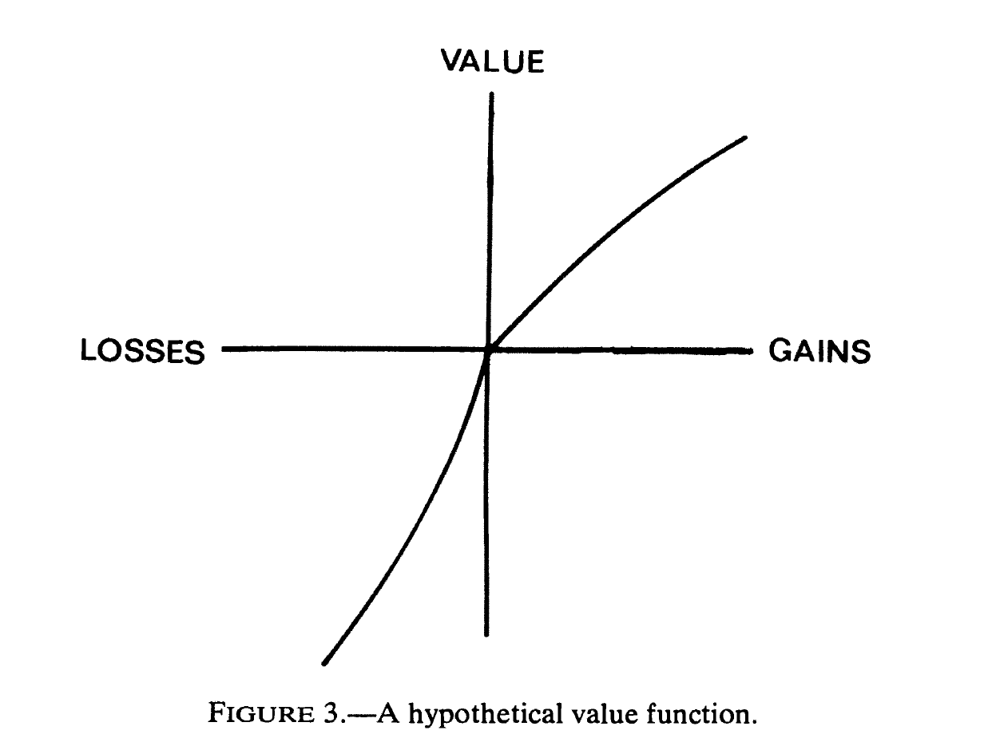{.lightbox height="420px"}


[@kahneman_prospect_1979, p. 279]


## The Value Function (revisited)


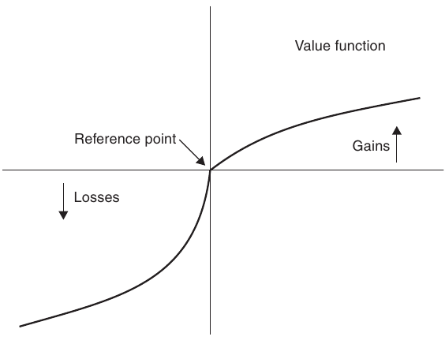{.lightbox height="420px"}


[@camerer_advances_2003, p. 636]


## The Value Function (revisited)


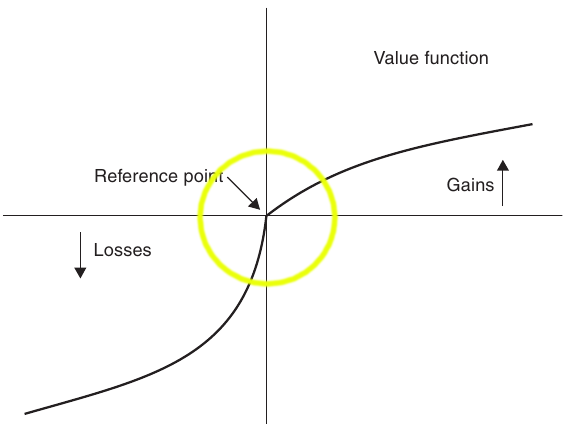{.lightbox height="420px"}


[@camerer_advances_2003, p. 636]


## The Value Function (revisited)


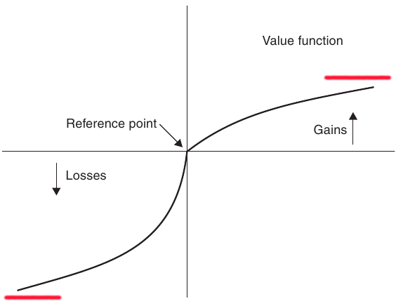{.lightbox height="420px"}

[@camerer_advances_2003, p. 636]


## The Value Function and Mental Accounting (1)

:::{.incremental}


- The value function is defined over gains and losses relative to some ***reference point***
  - This reference point is not fixed
<br>

- The focus on changes, rather than wealth levels as in expected utility theory, reflects the ***piecemeal nature of mental accounting***.

- Transactions are often evaluated one at a time, rather than in conjunction with everything else

:::

## Reference Point

{.lightbox height="420px"}

## The Value Function and Mental Accounting (2)

:::{.incremental}

- Both the gain and loss functions display ***diminishing sensitivity***

- The gain function is **concave** and the loss function is **convex**

- the difference between $10 and $20 seems bigger than the difference between $1000 and $1010
  - (irrespective of the sign)
  - (the Weber-Fechner law)
:::

## Diminishing Sensitivity

{.lightbox height="420px" aligh="center"}

## The Value Function and Mental Accounting (3)

:::{.incremental}


- ***Loss-aversion***

- Losing $100 hurts more than gaining $100 yields pleasure:

<br>

- $v(x) < - v(-x)$
- $v(x) <  |v(-x)|$

- The influence of loss aversion on mental accounting is enormous
:::

## Loss aversion

{.lightbox height="420px" aligh="center"}


# Components of Mental Accounting


## Components of Mental Accounting

:::{.incremental}

- Evaluating

<br>

- Categorisation

<br>

- Balancing<br>
[@thaler_mental_2003]

:::

## Evaluating

:::{.incremental}

- How outcomes are perceived and experienced, and how decisions are made and subsequently evaluated.


  - The accounting system provides the inputs to do cost—benefit analyses (both before and after decision)


-  The consumer’s choice can be understood by incorporating the value of the “deal” (termed *transaction utility*) into the purchase decision calculus.<br>
[@thaler_mental_2003]

:::

## Evaluating


>"A friend of mine was once shopping for a quilted bedspread. She went to a department store and was pleased to find a model she liked on sale. The spreads came in three sizes: double, queen and king. The usual prices for these quilts were $\$200$, $\$250$ and $\$300$ respectively, but during the sale they were all priced at only $\$150$. My friend bought the king-size quilt and was quite pleased with her purchase, though the quilt did hang a bit over the sides of her double bed" [taken from @thaler_mental_2003, p. 75]


## Categorisation

:::{.incremental}

- Assignment of activities to specific *accounts*
  - Both **sources** and **uses** of funds are labeled in real and mental accounting systems

- Expenditures grouped into categories (housing, food, etc.)
  - Spending can be constrained by implicit or explicit budgets
- Funds to spend are also labeled, both as flows (regular income versus windfalls) and as stocks (cash on hand, home equity, pension wealth, etc.) [@thaler_mental_2003]

:::

## Categorisation


> "A few years ago I gave a talk to a group of executives in Switzerland. After the conference my wife and I spent a week visiting the area. At that time the Swiss franc was at an all-time high relative to the US dollar, so the usual high prices in Switzerland were astronomical. My wife and I comforted ourselves that I had received a fee for the talk that would easily cover the outrageous prices for hotels and meals. Had I received the same fee a week earlier for a talk in New York though, the vacation would have been much less enjoyable" [taken from @thaler_mental_2003, p. 75]


## Categorisation


> "A former colleague of mine, a professor of finance, prides himself on being a thoroughly rational man. Long ago he adopted a clever strategy to deal with life’s misfortunes. At the beginning of each year he establishes a target donation to the local United Way charity. Then, if anything untoward happens to him during the year, for example an undeserved speeding ticket, he simply deducts this loss from the United Way account. He thinks of it as an insurance policy against small annoyances" [taken from @thaler_mental_2003, p. 75]


## Balancing{.smaller}

:::{.incremental}

- Frequency with which accounts are evaluated
  - **choice bracketing**<br> [@read_choice_2000]
  
- Accounts can be balanced daily, weekly, yearly, and so on
  - defined narrowly or broadly
  
- [A well-known song](https://youtu.be/7hx4gdlfamo?t=82)
  - “never count your money while you’re sitting at the table”
  - Excellent advice, in poker as well as in other situations involving decision making under uncertainty (such as investing).

- Balancing also involves opening and closing of mental accounts
<br>
[@thaler_mental_2003]

:::

## Accounting vs Mental Accounting

:::{.incremental}


- Mental accounting rules not neutral

- Attractiveness of choices influenced by:
  - Which category a purchase is assigned to
  - Combining outcomes with others in that category
  - Frequency the 'books' are 'balanced'
  
- Mental accounting violates the economic notion of *fungibility*
  - (units are interchangeable)

:::

## Recap activity

- Individually or in groups
  - Identify different mental accounts that you use

# Decision Frames

## Decision Frames{.smaller}

:::{.incremental}

- Framing of outcomes <br> ['outcome frames' @kahneman_choices_2000; 'entries' @thaler_mental_2003]
  - Minimal account
      - only the differences between the two options (disregarding all their common features)
  - Topical account
      - consequences of possible choices to a reference level that is determined by the context within which the decision arises
  - Comprehensive account
      - all (other) factors including current wealth, future earnings, possible outcomes of other probabilistic holdings etc.

:::


## Decision Frames

::: {.fragment fragment-index=2}

::::{.columns}

:::{.column width="60%"}

{.lightbox height="300px" align="left"}

:::

:::{.column width="40%"}

{.lightbox height="300px" align="right"}

:::

::::

:::


- Economic theory generally assumes that people make decisions using the comprehensive account


::: {.fragment fragment-index=1}

- ***but***

:::


## Decision Frames


::::{.columns}

:::{.column width="60%"}

{.lightbox height="300px" align="left"}

€125

:::

:::{.column width="40%"}

{.lightbox height="300px" align="right"}

€15 / €10

:::

::::


::: {.fragment fragment-index=1}

<font size=4.9>Imagine that you are about to purchase a jacket for €125 and a calculator for
€15. The calculator salesman informs you that the calculator you wish to buy is
on sale for €10 at the other branch of the store, located 20 minutes drive away.
Would you make the trip to the other store?</font><font size=4.5> [@tversky_framing_1981, p. 459] </font>

:::

## Decision Frames


::::{.columns}

:::{.column width="60%"}

{.lightbox height="300px" align="left"}

€15

:::

:::{.column width="40%"}

{.lightbox height="300px" align="right"}

€125 / €120

:::

::::


::: {.fragment fragment-index=1}

<font size=4.9>Imagine that you are about to purchase a jacket for €15 and a calculator for
€125. The calculator salesman informs you that the calculator you wish to buy is
on sale for €120 at the other branch of the store, located 20 minutes drive away.
Would you make the trip to the other store?</font><font size=4.5> [@tversky_framing_1981, p. 459]</font>

:::


## Decision Frames{.smaller}

:::{.incremental}

- Most people will drive when the item costs €15 but not €125 <br> [@tversky_framing_1981; @thaler_mental_2003; @ranyard_economic_2018; @moon_mental_1999] 
  
- Minimal account:
  - Driving to save €5
- Comprehensive account:
  - $W$* $=$ Existing wealth $+$ jacket $+$ calculator $-$ €140
      - $W$* $+$ €5
  - *versus*
      - utility of $W$* $+$ 20mins
- Topical account: ***piecemeal***
 
:::


## Hedonic Framing


- (Maximise pleasure/minimise pain)

- Individually/In groups:
  - How should joint outcomes be evaluated to maximise utility?
  - Use your knowledge of the value function:
      - Shape of gain function vs loss function
      - Diminishing sensitivity
      - Loss aversion


## Principles of Hedonic Framing{.smaller}

:::{.incremental}

1. Segregate gains <br><font size=4.5>(because the gain function is concave)</font>
2. Integrate losses <br><font size=4.5>(because the loss function is convex)</font>
3. Integrate smaller losses with larger gains <br><font size=4.5>(to offset loss aversion)</font>
4. Segregate small gains (silver linings) from larger losses <br><font size=4.5>(because the gain function
is steepest at the origin, the utility of a small gain can exceed the utility of slightly reducing a large loss)<br>[@thaler_mental_2003, p. 79]</font>

- Application of these principles in marketing?
  - rebate *vs* temporary price reduction

:::

# Fairness and Ethics


## Overview

- Reciprocity
- Public Goods
- Third Party Punishment
- Moral Judgment


## Reciprocity{.smaller}

:::{.fragment}

- **Reciprocity**: *like with like* responding
  - In response to friendly actions, people are frequently nicer and more cooperative
  - In response to hostile actions they are frequently much more nasty and even brutal
      - Much more so than predicted by the self-interest model
- '*A man ought to be a friend to his friend and repay gift with gift. People should meet smiles with smiles and lies with treachery*' [@fehr_fairness_2003, p. 510]

- Cooperative reciprocal tendencies: ***positive reciprocity***
- Retaliatory tendencies: ***negative reciprocity***

:::

## Reciprocity (contd.){.smaller}

:::{.fragment}

- Reciprocity $\ne$ cooperative/retaliatory behaviour in repeated interactions
  - These behaviors arise because actors expect future material benefits from their actions

- For reciprocity, the actor is responding to friendly or hostile actions ***even if no material gains can be expected***

- Reciprocity is also fundamentally different from altruism
  - Altruism is a form of unconditional kindness
      - altruism given does not emerge as a response to altruism received

- Reciprocity is an in-kind response to beneficial or harmful acts [@fehr_fairness_2003, p. 511]

:::

## Reciprocity: Examples and Evidence{.smaller}

:::{.incremental}

- *In groups* Identify as many examples of reciprocity as you can think of

- Positive reciprocity
  - Smiling waitresses get tipped more [@tidd_monetary_1978]
  - Charities looking for donations provide small gifts
  - Free samples to increase sales [@cialdini_psychology_1993]
  
- Negative reciprocity
  - War
  - Gang related crime
  - Increases in rates of theft in firms increase following wage cuts [@giacalone_antisocial_1997]

:::

# Studying Reciprocity

## Ultimatum/Dictator Games


- <font color="#6666ff">Player 1 (Proposer)</font> may divide a sum of money (e.g., €100) <br>with <font color="#ff4c4c">Player 2 (Responder)</font>

<br>

- <font color="#ff4c4c">Player 2</font> can accept or reject the offer
  - If  <font color="#ff4c4c">Player 2</font> rejects, **both** players get **nothing**

## Ultimatum/Dictator Games: Results{.smaller}

:::{.fragment}

- If the <font color="#6666ff">Proposer</font> offers $< 30\%$ the <font color="#ff4c4c">Responder</font> is highly likely to reject <br><font size=4.5>[@roth_bargaining_1995; @guth_experimental_1982; @camerer_anomalies_1995; @fehr_fairness_2003]</font> 


- Observed in various countries: Europe, USA, Asia
 <br><font size=4.5>[@roth_bargaining_1991; @fehr_fairness_2003]</font>
  - [Although seemingly not in the Peruvian Amazon, @henrich_does_2000]
 
- Minimal influence of higher stakes
  - Three months income
  - Student sample: $$100$ or more <br><font size=4.5>[@cameron_raising_1999; @fehr_fairness_2003; @slonim_learning_1998; @hoffman_ultimatum_1995]</font>

:::

## Trust/Gift Exchange Games

:::{.fragment}

- A <font color="#6666ff">Proposer</font> receives an amount of money <font color="#0c840c">$x$</font> from the experimenter
  - Sends amount <font color="#0c840c">$y$</font> to the <font color="#ff4c4c">Responder</font>
  - <font color="#0c840c">$0 \leq y \leq x$</font>
  
- The experimenter then triples the amount sent
  - <font color="#ff4c4c">Responder</font> has <font color="#0c840c">$3y$</font>
  - The <font color="#ff4c4c">Responder</font> is then free to return a value <font color="#0c840c">$z$</font> between <font color="#0c840c">$0$</font> and <font color="#0c840c">$3y$</font> to the <font color="#6666ff">Proposer</font>
  - <font color="#0c840c">$0 \leq z \leq 3y$</font>

:::

## Trust/Gift Exchange Results{.smaller}

:::{.fragment}

- Many <font color="#6666ff">Proposers</font> send money and many <font color="#ff4c4c">Responders</font> give back some money
- Frequently a positive correlation between <font color="#0c840c">$y$</font> and <font color="#0c840c">$z$</font> the amount sent back
  - At both the individual as well as at the aggregate level<br><font size=4.5>[@berg_trust_1995; @fehr_does_1993; @mccabe_game_1996]</font>

- As with negative reciprocity, positive reciprocity does not appear to be affected by higher/lower stakes
  - @fehr_high_1995 provided subjects with $\approx 10$ weeks wages
      - for a $2$ hour study

:::


## Fairness *vs* Selfishness

:::{.incremental}

- $40\% - 66\%$ of people behave reciprocally in one-shot situations
  - Showing concern for fairness (reciprocal types)
- ***but***
- $20\% - 30%$ of participants do not reciprocate
  - Behave completely selfishly (self interested types)
      - *Selfish Minority*<br><font size=4.5>[@gachter_reputation_1999; @berg_trust_1995; @fehr_wage_1999; @abbink_moonlighting_2000]</font>

:::


## Fairness *vs* Selfishness: Causes{.smaller}

::::{.columns}

:::{.column width=70%}

:::{.fragment fragment-intex=2}

- Linked with testosterone in males<br><font size=4.5>[@burnham_hightestosterone_2007]</font>

- Desire to maintain equity: <br>*Inequality Aversion* <font size=4.5>[@bolton_inequality_2006]</font>

- Desire to punish hostile intentions and to reward kind intentions <br><font size=4.5>[@rabin_incorporating_1993; @blount_when_1995; @dufwenberg_theory_2004; @falk_theory_1999]</font>

- Type of person <font size=4.5>[@levine_modeling_1998]</font>

- Boundedly rational <font size=4.5>[@gale_learning_1995; @roth_learning_1995]</font>

:::

:::

:::{.column width=30%}

:::{.fragment fragment-index=1}

{.lightbox}
:::

:::
::::

## Fairness *vs* Selfishness: Causes


- No agreement on cause
  - But agreement that reciprocity is **stable**

- Implications and applications of reciprocity:
  - Discuss in groups.
  
## Implications and Applications


- How does reciprocity change the nature of collective action? <br><font size=4.5>(e.g., in firms, public bureaucracies, markets and the political sphere?)</font>

- Can reciprocal people constrain the opportunistic tendencies of selfish people?

- When (and where) does reciprocity thrive over selfishness? (and vice-versa?)

- Do explicit incentives crowd out or enhance voluntary cooperation?


# Public Goods

## Public Goods

:::{.fragment}

- How should public goods be provided?

- Self interest dictates that everyone wants to 'free-ride' on the efforts of others

:::

. . .

{.lightbox width=40%}


## Public Goods in the Lab


> - In groups: Use your knowledge of the topics we've covered this semester to design a "Public Goods" Game


## Public Goods in the Lab

:::{.fragment}

- @fehr_cooperation_2000
  - $4$ group members
      - $20$ tokens each

- Tokens may be *kept* or *invested*
  - *Keeping* $1$ token earns $1$ token 
  - An *invested* token earns $0.4$ of a token for each player
      - Private return on *investing* $= 0.4$ tokens
      - Social return on *investing* &nbsp; $= 1.6$ tokens

:::

## Public Goods in the Lab (contd.)


::::{.columns}

:::{.column width=70%}

:::{.fragment}

- If everyone *Keeps* **everything**:
  - Everyone earns $20$ tokens
- If everyone *invests* **everything**:
  - Everyone earns $32$ tokens <br>$(4 \times 0.4 \times 20)$
  
:::


:::

:::{.column width=30%}

{.lightbox}


:::

::::


:::{.fragment}

- But it is in everyone's (private) interest to invest nothing and 'free ride'
  - *Keeping* is ***strictly dominant***

:::

## Public Goods and Reciprocity{.smaller}

:::{.fragment}

- Positive reciprocity implies that people are willing to contribute something to the public good ***if*** others are also willing to contribute
- Contribution to the public good represents a kind action
  - Which induces reciprocally motivated people to contribute too <br><font size=4.5>[@sugden_reciprocity_1984; @fehr_fairness_2003]</font>

:::

:::{.fragment}

- ***But***
:::

:::{.fragment}

  - *Selfish Minority*<br><font size=4.5>[@gachter_reputation_1999; @berg_trust_1995; @fehr_wage_1999; @abbink_moonlighting_2000]</font>
      - $20\% - 30%$ of participants do not reciprocate
- Can a positive level of contributions to the public good can be sustained as an equilibrium?

:::

## Public Goods and Reciprocity{.smaller}

:::{.incremental}

- The game used by @fehr_cooperation_2000 did not have any opportunity for direct retaliation in response to observed free riding
- Indirect negative reciprocity is possible
  - If subjects people interpret others' free riding that as a hostile act
      - They can “punish” others by also free riding
- Different motivations, but everyone ends up free riding
  - Self-interested types choose to free ride because they are self-interested
  - Reciprocal types free-ride because they observe others free-riding

<br>

- Examples?

:::


## Reciprocal Free Riding


::::{.columns}

:::{.column width=45%}

:::{.fragment}

{.lightbox}
:::

:::

:::{.column width=45%}

:::{.fragment}

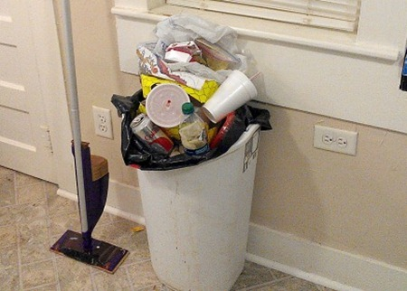{.lightbox}

:::

:::

::::

. . .

Recall the @ross_egocentric_1979 housework study?

## Negative Reciprocity

:::{.incremental}

- What if someone is watching?

<br>

- The impact of negative reciprocity changes radically if subjects are given the opportunity to observe the contributions of others
  - and to punish those who do not contribute

:::

## Alternative Public Goods Game{.smaller}

:::{.fragment}

- Suppose each subject in a group has the opportunity to reduce the income of each other subject in the group
- e.g., reduction of the income of one other group member by <font color="#0c840c">$x$</font> tokens
- Punishing costs <font color="#0c840c">$\frac{1}{3} \times x$</font>
  - Which means selfish subjects will never punish<br><font size=4.5>(If all subjects were purely self-interested, contributions would be unaffected by the punishment opportunity)</font>

  - Negatively reciprocal type subjects, will use the costly punishment opportunity to punish free riders

- The public good game with direct punishment provides an opportunity for reciprocal types to induce the selfish types to make “cooperative” choices

:::

## Public Goods and Punishment{.smaller}


- Same structure as previous $4$ person $20$ token game
- $2$ versions:
  - "Perfect stranger"
      - Participant groups *shuffled* after each trial
      - $6$ groups of $4$ completed $6$ trials
      - Nobody met another group member more than once
  - "Partner"
      - Same $4$ group members across $10$ trials
- Opportunity to **punish** after each trial (no punishment in control groups)
<br><font size=4.5>[@fehr_cooperation_2000]</font>


## Public Goods and Punishment: Results


## Public Goods and Punishment: Results{.scrollable}


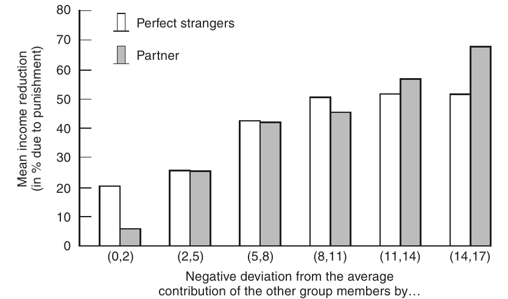{.lightbox}


<font size=4.5>Mean income reduction for a given negative deviation from the mean contribution of other group members. Source: Fehr and Gächter 2000. [taken from @fehr_fairness_2003, p. 516]</font>


## Public Goods and Punishment: Results{.smaller}


- Negative deviations from the Mean contributions of other group members was punished
- The larger the deviation the larger the punishment
- The more a subject free rides relative to the others the more it gets punished
- Moreover, this pattern is almost the same in the two versions of the game:
  - Free riders are punished irrespective of whether there are future rewards for the punisher
- Questionnaire evidence suggests that the deviation from the norm of cooperation causes resentment and the impulse to punish


## Public Goods and Punishment: Results{.scrollable}


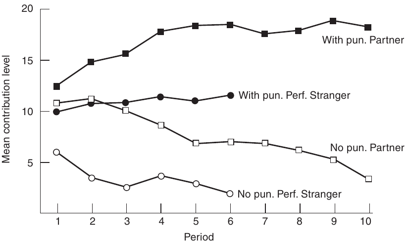{.lightbox}


<font size=4.5>Evolution of average contributions with and without the punishment option in the Partner and the Perfect Stranger condition. Source: Fehr and Gächter 2000. [taken from @fehr_fairness_2003, p. 517]</font>


## Public Goods and Punishment: Results


- Absence of punishment leads to smaller contributions
  - (As predicted)
- Punishment leads to higher contributions


## Punishment and 'Free-riding'{.scrollable}

<iframe width="966" height="543" src="https://www.youtube.com/embed/8SOQduoLgRw?start=622" frameborder="0" allow="accelerometer; autoplay; encrypted-media; gyroscope; picture-in-picture" allowfullscreen></iframe>

<font size=4>Jonathan Haidt discussing @fehr_altruistic_2002</font>

# Social Norms

## From Public Goods to Social Norms


- Failure to behave "fairly" results in punishment
  - Where behaving fairly is the **norm**
- Behaviours that deviate from the **norm** are punished (sanctioned)
  - Sanctioning is often costly

## Sanctioning and Norms


{.lightbox}

## Sanctioning and Norms


## Sanctioning and Norms


## Sanctioning can be Costly


::::{.columns}

:::{.column width=45%}


:::

:::{.column width=45%}


:::

::::

. . .


Which is more costly? The sanction or the consequence of not sanctioning 

## Norms{.smaller}

- Norms are pervasive in social and economic life
- The large majority of interactions in people’s lives are not regulated by explicit contracts
  - but by informal social norms.
- Norm-governed attitudes, social interactions, and conformism among peers, among relatives, and in neighborhoods
  - May have important consequences for human capital decisions
  - The decision to take part in elections
  - Criminal activities
      - Tax evasion
      - Abuse of welfare payments

# Third Party Punishment

## Third Party Punishment{.smaller}

:::{.fragment}

- Third Party Punishment in the Dictator game

- Players <font color="#6666ff">**A** (Dictator)</font>, <font color="#ff4c4c">**B** (Recipient)</font> and <font color="#b665c4">**C** (Third Party)</font>

:::
:::{.fragment}

- <font color="#6666ff">**A**</font> has $100$ points
  - Can give $0, 10, 20, 30, 40, or$ $50$ points to <font color="#ff4c4c">**B**</font>

:::

:::{.fragment}

- <font color="#ff4c4c">**B**</font> has nothing 

:::

:::{.fragment}

- <font color="#b665c4">**C**</font> (has $50$ points) can sanction <font color="#6666ff">**A**</font>
  - assigning a sanction “costs” points
  - e.g., <font color="#b665c4">**C**</font> spends $1$ point to deduct $3$ points from <font color="#6666ff">**A**</font><br><font size=4.5>[@fehr_third_2004]</font>

:::

## Third Party Punishment


Variables of Interest:

:::{.fragment}

  - **Frequency** of punishment
      - Both *actual* and *expected*

:::

:::{.fragment}

  - **Severity** of punishment
      - Both *actual* and *expected*

:::

:::{.fragment}

  - Level/value of **transfer** (from dictators)
      - Both *actual* and *expected*

:::

## Third Party Punishment


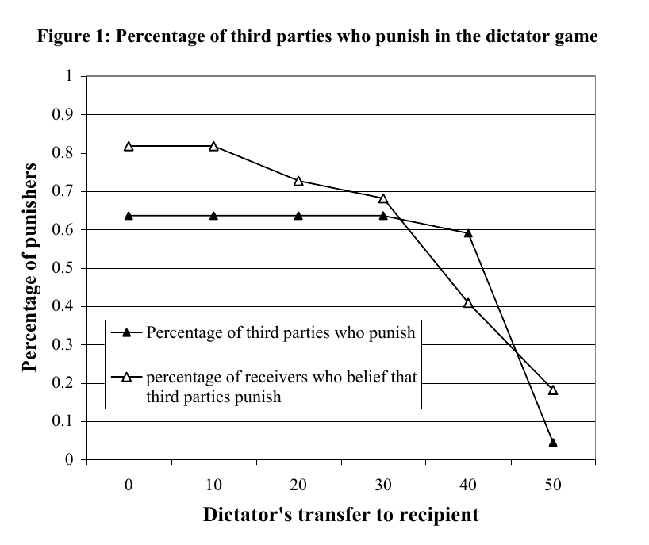{.lightbox height="480px"}

Frequency of punishment [@fehr_third_2004, p. 69]


## Third Party Punishment


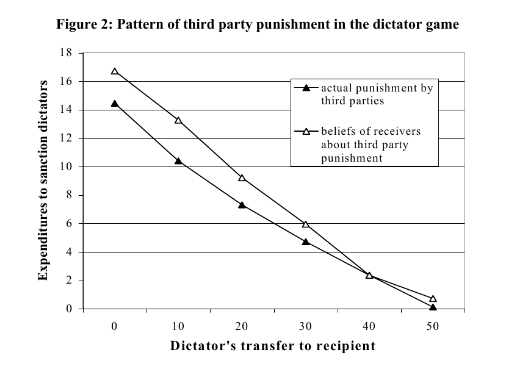{.lightbox height="480px"}

[@fehr_third_2004, p. 70]

## Third Party Punishment


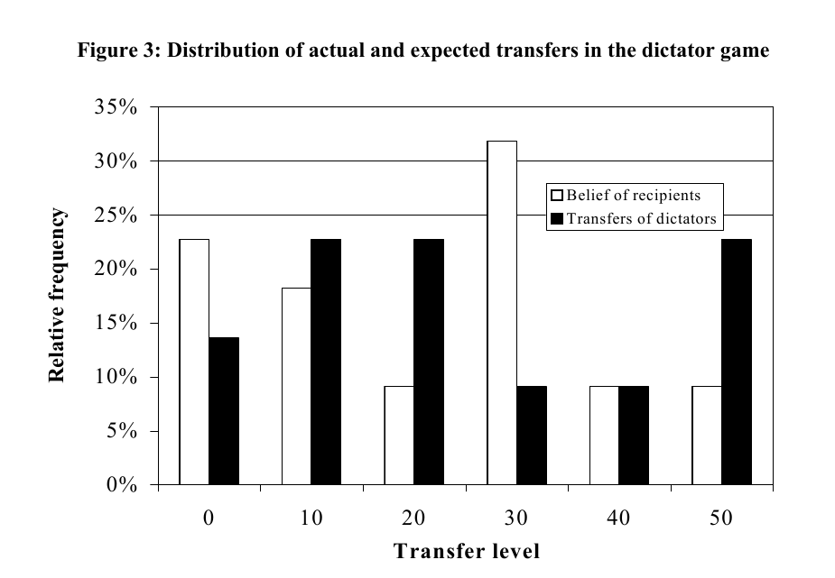{.lightbox height="480px"}

[@fehr_third_2004, p. 71]


## Punishment Expectation


- Recipients’ beliefs about punishment appear to be higher than the actual punishment

- Recipients overestimate both the strength and frequency of punishment

- For each reduction of the transfer by 10 units, the recipients expect that the third parties will reduce the dictators’ income by 9.9 units


## Second and Third Party Punishment


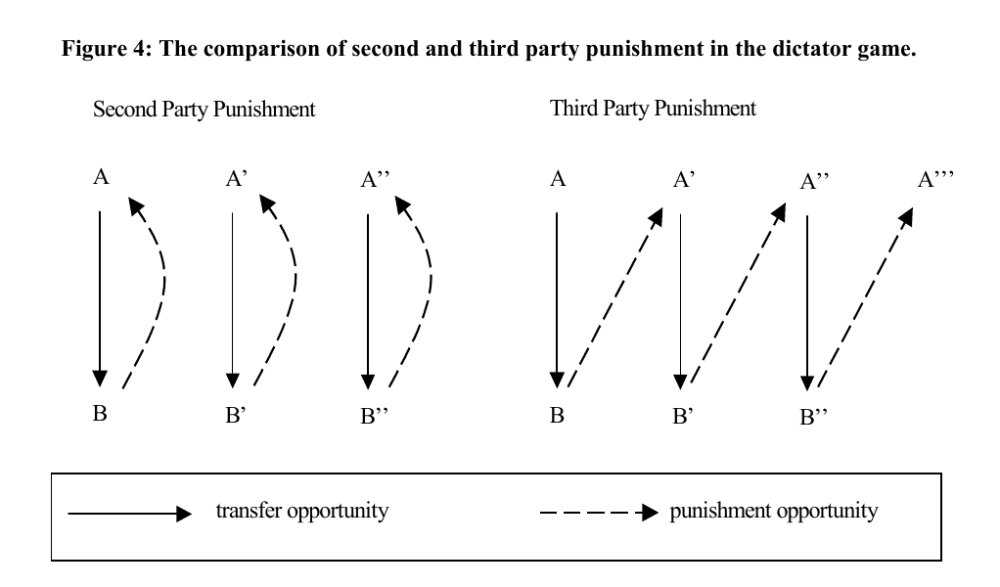{.lightbox height="480px"}

[@fehr_third_2004, p. 75]

## Second and Third Party Punishment


- Variables of Interest:
  - Expenditure to sanction dictator
      - Both *second* and *third* party
  - Expected payoff for dictator
      - Both *second* and *third* party


## Second and Third Party Punishment


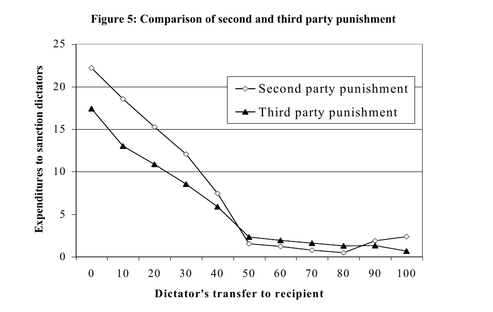{.lightbox height="480px"}

[@fehr_third_2004, p. 78]

## Second and Third Party Punishment


- Dictators face severe sanctions in the second and third party condition

- Second party sanctions for transfers below the egalitarian level are considerably stronger than those of the third party

- Low transfers are profitable for the dictators in the TP condition but not in the SP condition


## Second and Third Party Punishment


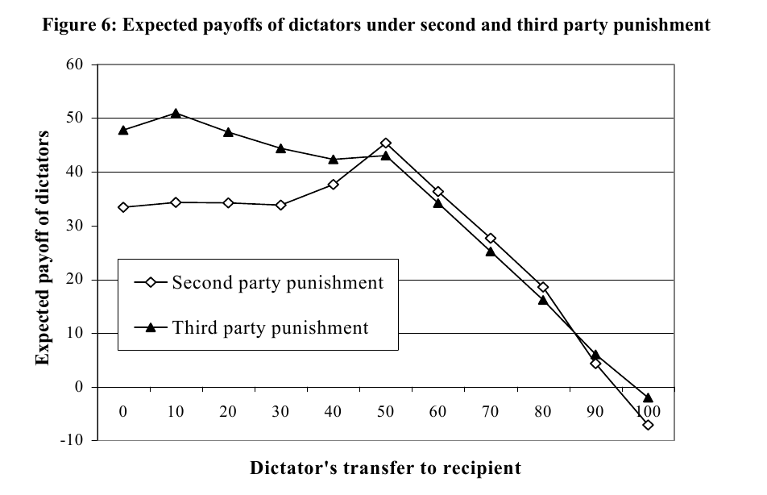{.lightbox height="480px"}

Expected payoff [@fehr_third_2004, p. 79]{.lightbox height="480px"}


# 'Ethical' Payoff Matrices

## Representing Ethical Considerations


Pure co-ordination game

<center>
<table class = 'table-style-one'>
<col width="200px" />
<col width="200px" />
<col width="200px" />
<col width="200px"/>
<tr class="odd">
<td colspan = "2" rowspan = "2"></td>
<td colspan = "2" align="center"><font color="#ff4c4c">Player B</font></td>
</tr>
<tr class="even">
<td align="center"><font size = 5px>b~1~</font></td>
<td align="center"><font size = 5px>b~2~</font></td>
</tr>
<tr class="odd">
<td rowspan = "2" align = "center"><font color="#6666ff">Player A</font></td>
<td align="center"><font size = 5px>a~1~</font></td>
<td align="center"><font color="#6666ff">1</font> , <font color="#ff4c4c">1</font></td>
<td align="center"><font color="#6666ff">0</font> , <font color="#ff4c4c">0</font></td>
</tr>
<tr class="even">
<td align="center"><font size = 5px>a~2~</font></td>
<td align="center"><font color="#6666ff">0</font> , <font color="#ff4c4c">0</font></td>
<td align="center"><font color="#6666ff">1</font> , <font color="#ff4c4c">1</font></td>
</tr>
</table>
</center>
<br>
<font size=4.5>[adapted from @pingle_ethics_2017, p. 565]</font size>


## Representing Ethical Considerations


Co-ordination game with penalties and rewards

<center>
<table class = 'table-style-one'>
<col width="200px" />
<col width="200px" />
<col width="200px" />
<col width="200px"/>
<tr class="odd">
<td colspan = "2" rowspan = "2"></td>
<td colspan = "2" align="center"><font color="#ff4c4c">Player B</font></td>
</tr>
<tr class="even">
<td align="center"><font size = 5px>b~1~</font></td>
<td align="center"><font size = 5px>b~2~</font></td>
</tr>
<tr class="odd">
<td rowspan = "2" align = "center"><font color="#6666ff">Player A</font></td>
<td align="center"><font size = 5px>a~1~</font></td>
<td align="center"><font color="#6666ff">1</font> , <font color="#ff4c4c">1</font></td>
<td align="center"><font color="#6666ff">1</font> , <font color="#ff4c4c">-1</font></td>
</tr>
<tr class="even">
<td align="center"><font size = 5px>a~2~</font></td>
<td align="center"><font color="#6666ff">-1</font> , <font color="#ff4c4c">1</font></td>
<td align="center"><font color="#6666ff">-1</font> , <font color="#ff4c4c">-1</font></td>
</tr>
</table>
</center>
<br>
<font size=4.5>[adapted from @pingle_ethics_2017, p. 565]</font size>


## Stag Hunt


Version of the Stag Hunt game

<center>
<table class = 'table-style-one'>
<col width="200px" />
<col width="200px" />
<col width="200px" />
<col width="200px"/>
<tr class="odd">
<td colspan = "2" rowspan = "2"></td>
<td colspan = "2" align="center"><font color="#ff4c4c">Player B</font></td>
</tr>
<tr class="even">
<td align="center"><font size = 5px>b~1~</font></td>
<td align="center"><font size = 5px>b~2~</font></td>
</tr>
<tr class="odd">
<td rowspan = "2" align = "center"><font color="#6666ff">Player A</font></td>
<td align="center"><font size = 5px>a~1~</font></td>
<td align="center"><font color="#6666ff">2</font> , <font color="#ff4c4c">2</font></td>
<td align="center"><font color="#6666ff">0</font> , <font color="#ff4c4c">1</font></td>
</tr>
<tr class="even">
<td align="center"><font size = 5px>a~2~</font></td>
<td align="center"><font color="#6666ff">1</font> , <font color="#ff4c4c">0</font></td>
<td align="center"><font color="#6666ff">1</font> , <font color="#ff4c4c">1</font></td>
</tr>
</table>
</center>
<br>
<font size=4.5>[adapted from @pingle_ethics_2017, p. 568]</font size>


## Transformed Stag Hunt


<br>

<center>
<table class = 'table-style-one'>
<col width="200px" />
<col width="200px" />
<col width="200px" />
<col width="200px"/>
<tr class="odd">
<td colspan = "2" rowspan = "2"></td>
<td colspan = "2" align="center"><font color="#ff4c4c">Player B</font></td>
</tr>
<tr class="even">
<td align="center"><font size = 5px>b~1~</font></td>
<td align="center"><font size = 5px>b~2~</font></td>
</tr>
<tr class="odd">
<td rowspan = "2" align = "center"><font color="#6666ff">Player A</font></td>
<td align="center"><font size = 5px>a~1~</font></td>
<td align="center"><font color="#6666ff">2</font> , <font color="#ff4c4c">2</font></td>
<td align="center"><font color="#6666ff">0</font> , <font color="#ff4c4c">&#949;</font></td>
</tr>
<tr class="even">
<td align="center"><font size = 5px>a~2~</font></td>
<td align="center"><font color="#6666ff">1</font> , <font color="#ff4c4c">&#949;</font></td>
<td align="center"><font color="#6666ff">1</font> , <font color="#ff4c4c">1</font></td>
</tr>
</table>
</center>
<br>
<font size=4.5>[adapted from @pingle_ethics_2017, p. 568]</font size>

## Transformed Stag Hunt


- In the previous example
  - If &#949; = 0 
    - Pareto dominant equilibrium
  - When &#949; > 2
    - Prisoners dilemma
  
- **Pareto dominant equilibrium**: impossible to switch to a better strategy without "hurting" the other player


# In-Class Activity

## In-class Activity


- Discuss the following:

<br>

- Can you identify any other methods for studying the influence of fairness and ethics in decision making?


# References

## References

\noindent
\vspace{-2em}
\setlength{\parindent}{-0.5in}
\setlength{\leftskip}{0.5in}
\setlength{\parskip}{7.5pt}
