## Overview

<style type="text/css">
    table.table-style-one {
        font-size:36px;
        color:#333333;
        border-width: 1px;
        border-color: #D3D3D3;
        border-collapse: collapse;
    }
    table.table-style-one th {
        border-width: 1px;
        padding: 16px;
        border-style: solid;
        border-color: #3A3A3A;
        background-color: #B3B3B3;
    }
    table.table-style-one td {
        border-width: 1px;
        padding: 16px;
        border-style: solid;
        border-color: #D3D3D3;
        background-color: #ececec;
    }
</style>


```{r include=FALSE}
# <style type="text/css">
#     ol { list-style-type: lower-alpha; }
# </style>
```


```{r setup, include=FALSE}
knitr::opts_chunk$set(echo = FALSE)
knitr::opts_chunk$set(include = FALSE)

```

- Reciprocity
- Public Goods
- Third Party Punishment
- Moral Judgment

## Recap on last week!
- 3 'components' of mental accounting?
- Principles of hedonic framing?

- Examples of mental accounting in your lives?

## Recap on last week!{.smaller}

- 3 'components' of mental accounting:
  - Evaluating
  - Categorisation
  - Balancing
- Principles of hedonic framing
  - segregate gains
  - integrate losses
  - integrate smaller losses with larger gains
  - segregate small gains from larger losses

# Fairness and Ethics

## Reciprocity{.smaller}


- **Reciprocity**: *like with like* responding
  - In response to friendly actions, people are frequently nicer and more cooperative
  - In response to hostile actions they are frequently much more nasty and even brutal
      - Much more so than predicted by the self-interest model
- '*A man ought to be a friend to his friend and repay gift with gift. People should meet smiles with smiles and lies with treachery*' [@fehr_fairness_2003, p. 510]

- Cooperative reciprocal tendencies: ***positive reciprocity***
- Retaliatory tendencies: ***negative reciprocity***


## Reciprocity (contd.){.smaller}

- Reciprocity $\ne$ cooperative/retaliatory behaviour in repeated interactions
  - These behaviors arise because actors expect future material benefits from their actions

- For reciprocity, the actor is responding to friendly or hostile actions ***even if no material gains can be expected***

- Reciprocity is also fundamentally different from altruism
  - Altruism is a form of unconditional kindness
      - altruism given does not emerge as a response to altruism received

- Reciprocity is an in-kind response to beneficial or harmful acts [@fehr_fairness_2003, p. 511]

## Reciprocity: Examples and Evidence{.smaller}


- *In groups* Identify as many examples of reciprocity as you can think of


# Studying Reciprocity

## Ultimatum/Dictator Games


- <font color="#6666ff">Player 1 (Proposer)</font> may divide a sum of money (e.g., €100) <br>with <font color="#ff4c4c">Player 2 (Responder)</font>

<br>

- <font color="#ff4c4c">Player 2</font> can accept or reject the offer
  - If  <font color="#ff4c4c">Player 2</font> rejects, **both** players get **nothing**

## Ultimatum/Dictator Games: Results{.smaller}


- If the <font color="#6666ff">Proposer</font> offers $< 30\%$ the <font color="#ff4c4c">Responder</font> is highly likely to reject <br><font size=4.5>[@roth_bargaining_1995; @guth_experimental_1982; @camerer_anomalies_1995; @fehr_fairness_2003]</font> 


- Observed in various countries: Europe, USA, Asia
 <br><font size=4.5>[@roth_bargaining_1991; @fehr_fairness_2003]</font>
  - [Although seemingly not in the Peruvian Amazon, @henrich_does_2000]
 
- Minimal influence of higher stakes
  - Three months income
  - Student sample: $$100$ or more <br><font size=4.5>[@cameron_raising_1999; @fehr_fairness_2003; @slonim_learning_1998; @hoffman_ultimatum_1995]</font>


## Trust/Gift Exchange Games


- A <font color="#6666ff">Proposer</font> receives an amount of money <font color="#0c840c">$x$</font> from the experimenter
  - Sends amount <font color="#0c840c">$y$</font> to the <font color="#ff4c4c">Responder</font>
  - <font color="#0c840c">$0 \leq y \leq x$</font>
  
- The experimenter then triples the amount sent
  - <font color="#ff4c4c">Responder</font> has <font color="#0c840c">$3y$</font>
  - The <font color="#ff4c4c">Responder</font> is then free to return a value <font color="#0c840c">$z$</font> between <font color="#0c840c">$0$</font> and <font color="#0c840c">$3y$</font> to the <font color="#6666ff">Proposer</font>
  - <font color="#0c840c">$0 \leq z \leq 3y$</font>


## Trust/Gift Exchange Results{.smaller}


- Many <font color="#6666ff">Proposers</font> send money and many <font color="#ff4c4c">Responders</font> give back some money
- Frequently a positive correlation between <font color="#0c840c">$y$</font> and <font color="#0c840c">$z$</font> the amount sent back
  - At both the individual as well as at the aggregate level<br><font size=4.5>[@berg_trust_1995; @fehr_does_1993; @mccabe_game_1996]</font>

- As with negative reciprocity, positive reciprocity does not appear to be affected by higher/lower stakes
  - @fehr_high_1995 provided subjects with $\approx 10$ weeks wages
      - for a $2$ hour study


## Fairness *vs* Selfishness


- $40\% - 66\%$ of people behave reciprocally in one-shot situations
  - Showing concern for fairness (reciprocal types)
- ***but***
- $20\% - 30%$ of participants do not reciprocate
  - Behave completely selfishly (self interested types)
      - *Selfish Minority*<br><font size=4.5>[@gachter_reputation_1999; @berg_trust_1995; @fehr_wage_1999; @abbink_moonlighting_2000]</font>


## Fairness *vs* Selfishness: Causes


## Fairness *vs* Selfishness: Causes{.smaller}

::::{.columns}

:::{.column width=70%}


- Linked with testosterone in males<br><font size=4.5>[@burnham_hightestosterone_2007]</font>

- Desire to maintain equity: <br>*Inequality Aversion* <font size=4.5>[@bolton_inequality_2006]</font>

- Desire to punish hostile intentions and to reward kind intentions <br><font size=4.5>[@rabin_incorporating_1993; @blount_when_1995; @dufwenberg_theory_2004; @falk_theory_1999]</font>

- Type of person <font size=4.5>[@levine_modeling_1998]</font>

- Boundedly rational <font size=4.5>[@gale_learning_1995; @roth_learning_1995]</font>


:::

:::{.column width=30%}


:::
::::

## Fairness *vs* Selfishness: Causes


- No agreement on cause
  - But agreement that reciprocity is **stable**

- Implications and applications of reciprocity:
  - Discuss in groups.
  
## Implications and Applications


- How does reciprocity change the nature of collective action? <br><font size=4.5>(e.g., in firms, public bureaucracies, markets and the political sphere?)</font>

- Can reciprocal people constrain the opportunistic tendencies of selfish people?

- When (and where) does reciprocity thrive over selfishness? (and vice-versa?)

- Do explicit incentives crowd out or enhance voluntary cooperation?


# Public Goods

## Public Goods


- How should public goods be provided?

- Self interest dictates that everyone wants to 'free-ride' on the efforts of others


. . .

{width=40%}


## Public Goods in the Lab


> - In groups: Use your knowledge of the topics we've covered this semester to design a "Public Goods" Game


## Public Goods in the Lab


- @fehr_cooperation_2000
  - $4$ group members
      - $20$ tokens each

- Tokens may be *kept* or *invested*
  - *Keeping* $1$ token earns $1$ token 
  - An *invested* token earns $0.4$ of a token for each player
      - Private return on *investing* $= 0.4$ tokens
      - Social return on *investing* &nbsp; $= 1.6$ tokens


## Public Goods in the Lab (contd.)


::::{.columns}

:::{.column width=70%}


- If everyone *Keeps* **everything**:
  - Everyone earns $20$ tokens
- If everyone *invests* **everything**:
  - Everyone earns $32$ tokens <br>$(4 \times 0.4 \times 20)$
- But it is in everyone's (private) interest to invest nothing and 'free ride'
  - *Keeping* is ***strictly dominant***

:::

:::{.column width=30%}


:::

::::

## Public Goods and Reciprocity{.smaller}


- Positive reciprocity implies that people are willing to contribute something to the public good ***if*** others are also willing to contribute
- Contribution to the public good represents a kind action
  - Which induces reciprocally motivated people to contribute too <br><font size=4.5>[@sugden_reciprocity_1984; @fehr_fairness_2003]</font>
- ***But***
  - *Selfish Minority*<br><font size=4.5>[@gachter_reputation_1999; @berg_trust_1995; @fehr_wage_1999; @abbink_moonlighting_2000]</font>
      - $20\% - 30%$ of participants do not reciprocate
- Can a positive level of contributions to the public good can be sustained as an equilibrium?


## Public Goods and Reciprocity{.smaller}


- The game used by @fehr_cooperation_2000 did not have any opportunity for direct retaliation in response to observed free riding
- Indirect negative reciprocity is possible
  - If subjects people interpret others' free riding that as a hostile act
      - They can “punish” others by also free riding
- Different motivations, but everyone ends up free riding
  - Self-interested types choose to free ride because they are self-interested
  - Reciprocal types free-ride because they observe others free-riding

<br>

- Examples?


## Reciprocal Free Riding


## Reciprocal Free Riding


:::{.columns}

:::{.column width=45%}


:::

:::{.column width=45%}


&nbsp;

:::

::::


## Reciprocal Free Riding


::::{.columns}

:::{.column width=45%}


:::

:::{.column width=45%}


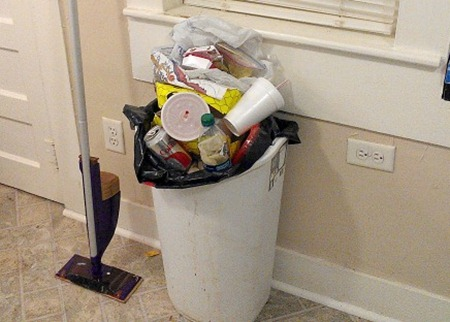

:::

::::

. . .

Recall the @ross_egocentric_1979 housework study?

## Negative Reciprocity


- What if someone is watching?

<br>

- The impact of negative reciprocity changes radically if subjects are given the opportunity to observe the contributions of others
  - and to punish those who do not contribute


## Alternative Public Goods Game{.smaller}


- Suppose each subject in a group has the opportunity to reduce the income of each other subject in the group
- e.g., reduction of the income of one other group member by <font color="#0c840c">$x$</font> tokens
- Punishing costs <font color="#0c840c">$\frac{1}{3} \times x$</font>
  - Which means selfish subjects will never punish<br><font size=4.5>(If all subjects were purely self-interested, contributions would be unaffected by the punishment opportunity)</font>

  - Negatively reciprocal type subjects, will use the costly punishment opportunity to punish free riders

- The public good game with direct punishment provides an opportunity for reciprocal types to induce the selfish types to make “cooperative” choices


## Public Goods and Punishment{.smaller}


- Same structure as previous $4$ person $20$ token game
- $2$ versions:
  - "Perfect stranger"
      - Participant groups *shuffled* after each trial
      - $6$ groups of $4$ completed $6$ trials
      - Nobody met another group member more than once
  - "Partner"
      - Same $4$ group members across $10$ trials
- Opportunity to **punish** after each trial (no punishment in control groups)
<br><font size=4.5>[@fehr_cooperation_2000]</font>


## Public Goods and Punishment: Results


## Public Goods and Punishment: Results


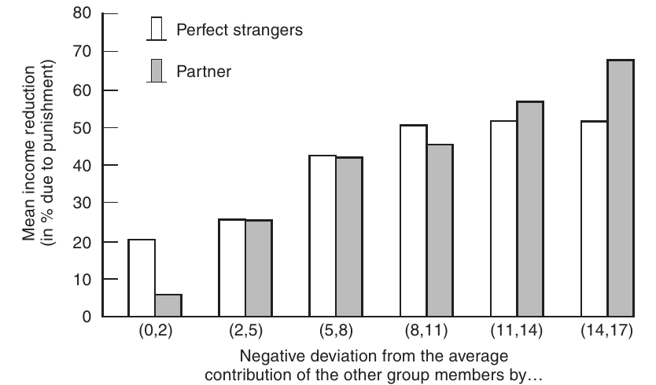


<font size=4.5>Mean income reduction for a given negative deviation from the mean contribution of other group members. Source: Fehr and Gächter 2000. [taken from @fehr_fairness_2003, p. 516]</font>


## Public Goods and Punishment: Results{.smaller}


- Negative deviations from the Mean contributions of other group members was punished
- The larger the deviation the larger the punishment
- The more a subject free rides relative to the others the more it gets punished
- Moreover, this pattern is almost the same in the two versions of the game:
  - Free riders are punished irrespective of whether there are future rewards for the punisher
- Questionnaire evidence suggests that the deviation from the norm of cooperation causes resentment and the impulse to punish


## Public Goods and Punishment: Results


<font size=4.5>Mean income reduction for a given negative deviation from the mean contribution of other group members. Source: Fehr and Gächter 2000. [taken from @fehr_fairness_2003, p. 516]</font>


## Public Goods and Punishment: Results


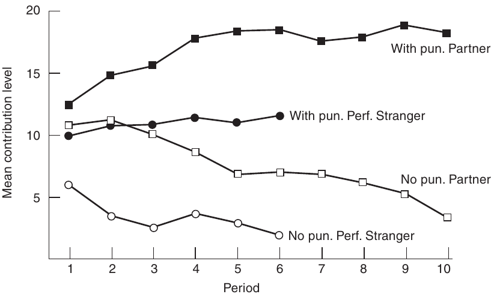


<font size=4.5>Evolution of average contributions with and without the punishment option in the Partner and the Perfect Stranger condition. Source: Fehr and Gächter 2000. [taken from @fehr_fairness_2003, p. 517]</font>


## Public Goods and Punishment: Results


- Absence of punishment leads to smaller contributions
  - (As predicted)
- Punishment leads to higher contributions

## Public Goods and Punishment: Results


<font size=4.5>Evolution of average contributions with and without the punishment option in the Partner and the Perfect Stranger condition. Source: Fehr and Gächter 2000. [taken from @fehr_fairness_2003, p. 517]</font>


## Punishment and 'Free-riding'

[https://www.youtube.com/embed/8SOQduoLgRw?start=622](https://www.youtube.com/embed/8SOQduoLgRw?start=622)

<iframe width="966" height="543" src="https://www.youtube.com/embed/8SOQduoLgRw?start=622" frameborder="0" allow="accelerometer; autoplay; encrypted-media; gyroscope; picture-in-picture" allowfullscreen></iframe>

&nbsp;&nbsp;&nbsp;&nbsp;&nbsp;&nbsp;&nbsp;&nbsp;&nbsp;<font size=4 color="white">Jonathan Haidt discussing @fehr_altruistic_2002</font>

# Social Norms

## From Public Goods to Social Norms


- Failure to behave "fairly" results in punishment
  - Where behaving fairly is the **norm**
- Behaviours that deviate from the **norm** are punished (sanctioned)
  - Sanctioning is often costly

## Sanctioning and Norms


## Sanctioning and Norms


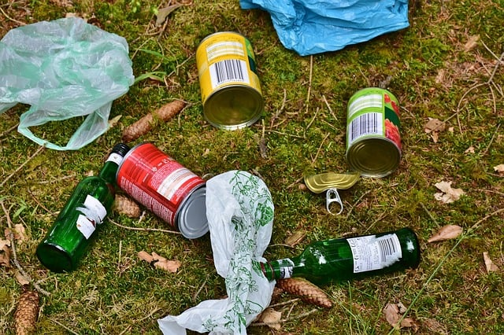


## Sanctioning can be Costly


::::{.columns}

:::{.column width=45%}


:::

:::{.column width=45%}


:::

::::

. . .


Which is more costly? The sanction or the consequence of not sanctioning 

## Norms{.smaller}

- Norms are pervasive in social and economic life
- The large majority of interactions in people’s lives are not regulated by explicit contracts
  - but by informal social norms.
- Norm-governed attitudes, social interactions, and conformism among peers, among relatives, and in neighborhoods
  - May have important consequences for human capital decisions
  - The decision to take part in elections
  - Criminal activities
      - Tax evasion
      - Abuse of welfare payments

# Third Party Punishment

## Third Party Punishment


- Third Party Punishment in the Dictator game

- Players <font color="#6666ff">**A** (Dictator)</font>, <font color="#ff4c4c">**B** (Recipient)</font> and <font color="#b665c4">**C** (Third Party)</font>

- <font color="#6666ff">**A**</font> has $100$ points
  - Can give $0, 10, 20, 30, 40, or$ $50$ points to <font color="#ff4c4c">**B**</font>
- <font color="#ff4c4c">**B**</font> has nothing 

- <font color="#b665c4">**C**</font> (has $50$ points) can sanction <font color="#6666ff">**A**</font>
  - assigning a sanction “costs” points
  - e.g., <font color="#b665c4">**C**</font> spends $1$ point to deduct $3$ points from <font color="#6666ff">**A**</font><br><font size=4.5>[@fehr_third_2004]</font>


## Third Party Punishment


- Variables of Interest:
  - Frequency of punishment
      - Both *actual* and *expected*
  - Severity of punishment
      - Both *actual* and *expected*
  - Level/value of transfer (from dictators)
      - Both *actual* and *expected*


## Third Party Punishment


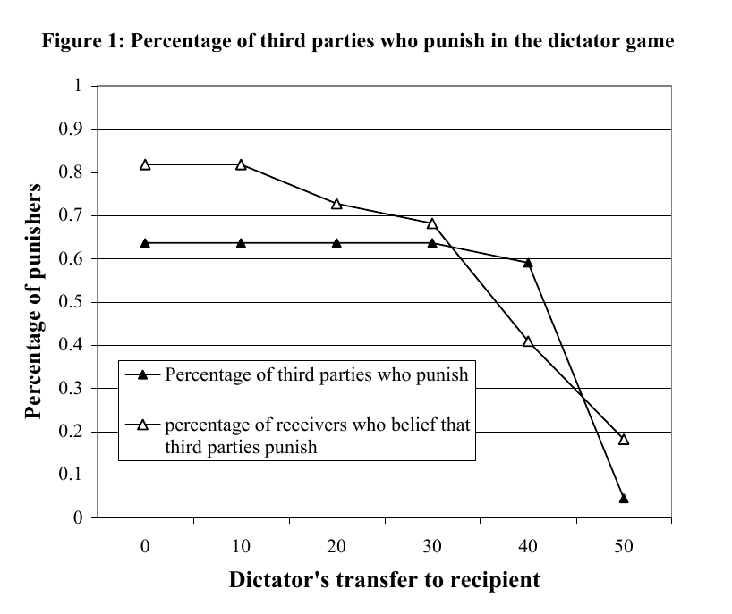

Frequency of punishment [@fehr_third_2004, p. 69]


## Third Party Punishment


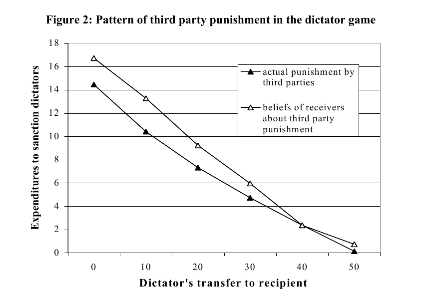

[@fehr_third_2004, p. 70]

## Third Party Punishment


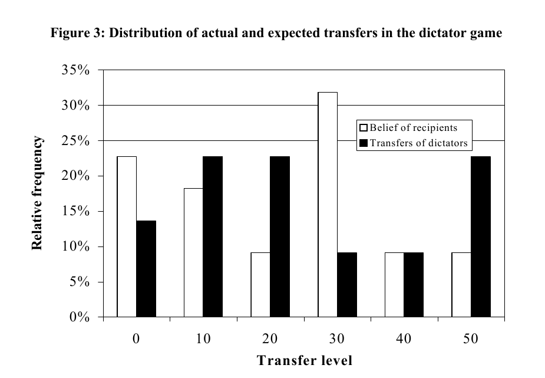

[@fehr_third_2004, p. 71]


## Punishment Expectation


- Recipients’ beliefs about punishment appear to be higher than the actual punishment

- Recipients overestimate both the strength and frequency of punishment

- For each reduction of the transfer by 10 units, the recipients expect that the third parties will reduce the dictators’ income by 9.9 units


## Second and Third Party Punishment


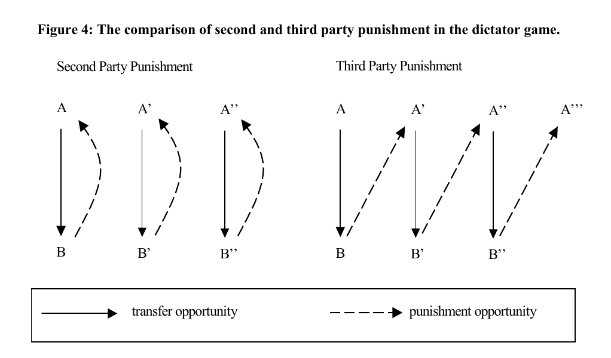

[@fehr_third_2004, p. 75]

## Second and Third Party Punishment


- Variables of Interest:
  - Expenditure to sanction dictator
      - Both *second* and *third* party
  - Expected payoff for dictator
      - Both *second* and *third* party


## Second and Third Party Punishment


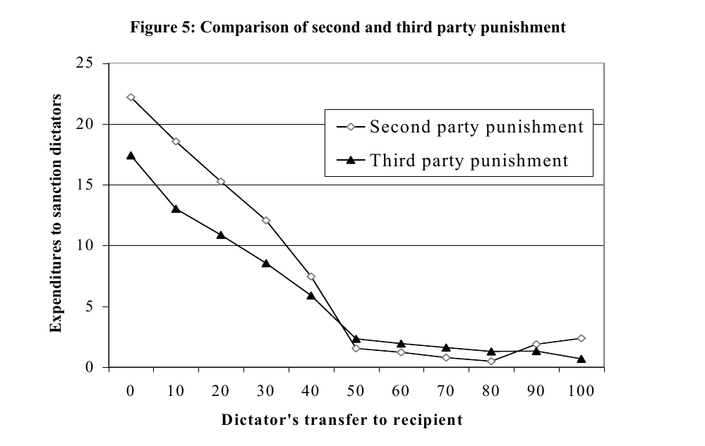

[@fehr_third_2004, p. 78]

## Second and Third Party Punishment


- Dictators face severe sanctions in the second and third party condition

- Second party sanctions for transfers below the egalitarian level are considerably stronger than those of the third party

- Low transfers are profitable for the dictators in the TP condition but not in the SP condition


## Second and Third Party Punishment


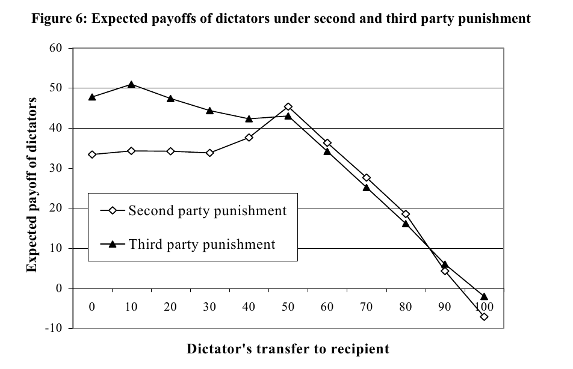

Expected payoff <font size=4.5>[@fehr_third_2004, p. 79]</font>


## Third Party Punishment


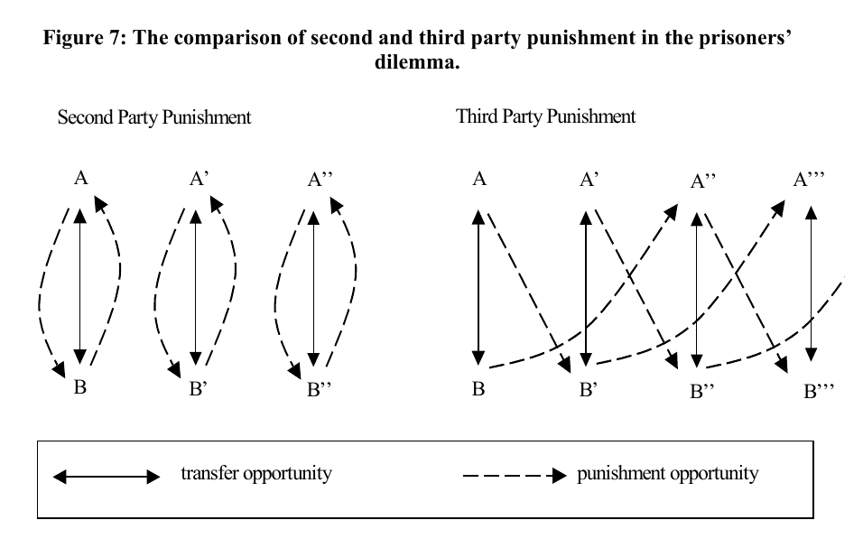

[@fehr_third_2004, p. 81]


# In-Class Activity

## In-class Activity


- Discuss the following:

<br>

- Can you identify any other methods for studying the influence of fairness and ethics in decision making?


# References

## References

\noindent
\vspace{-2em}
\setlength{\parindent}{-0.5in}
\setlength{\leftskip}{0.5in}
\setlength{\parskip}{7.5pt}
